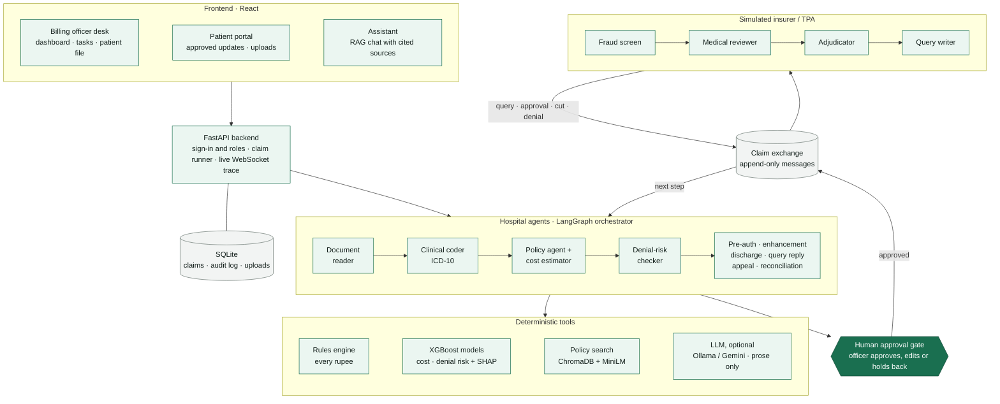
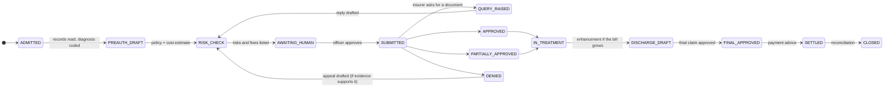

# ClaimPilot

**A team of AI agents that runs a hospital's cashless insurance claims from admission to settlement, catches problems before the insurer does, and never sends anything without a person approving it.**

Built for AgentOps 2026 (MIT Bengaluru × CGI) by Rudra Solanki and Janhavi Bhattad.

> All patient data in this repository is synthetic. The insurer/TPA on the other side is a **simulation** used as a test environment, not a real integration.

---

## The problem

In Indian cashless hospitalisation, the hospital's billing desk sends a pre-authorisation at admission, enhancements as the bill grows, and a final claim at discharge. Desks read long policy wordings by hand. They usually find out a claim is wrong only when the insurer queries, cuts or denies it, and the patient learns what they owe at the very end.

## What ClaimPilot does

| | |
| --- | --- |
| **Checks before sending** | Agents read the records, code the diagnosis, price the stay against the policy, and flag missing documents and likely cuts *before* the claim goes out. |
| **Exact, explainable money** | Every rupee comes from a deterministic rules engine (room-rent caps, proportionate deduction, sub-limits, co-pay, non-payables), each line tied to a policy clause. The LLM never does arithmetic. |
| **Human in charge** | A billing officer approves, edits or holds back every message to the insurer and every update to the patient. Each decision is in the audit log. |
| **Full claim lifecycle** | Pre-auth → insurer queries → enhancement → discharge → appeal → settlement → reconciliation of what was paid against what the policy allows. |
| **Patient portal** | Patients see officer-approved updates, their likely out-of-pocket cost and room advice, and can upload documents. |
| **Grounded assistant** | A RAG chatbot for officers and patients (ChromaDB + sentence embeddings). Every answer cites its sources and is checked: numbers must appear in a source, and it never promises an outcome. Judgement questions from patients go to the officer. |
| **Measured** | A benchmark compares a basic submission, a rules checklist and ClaimPilot on 55 held-out synthetic cases ([`reports/BENCHMARK.md`](reports/BENCHMARK.md)). |

On the synthetic benchmark, ClaimPilot caught **47 of 47** planted problems before sending (a basic submission caught 0), and insurer queries dropped from **5 to 0**. These are measured on synthetic data against a simulated insurer, and say nothing yet about real hospitals.

---

## Architecture



**Rules the code enforces**

- The LLM never does arithmetic. Every amount comes from `backend/rules/engine.py`.
- Every agent returns the same `AgentOutput` shape, and every finding names its source (a policy clause, bill line or document page).
- Claim state changes only through the orchestrator's state machine.
- Hospital and insurer agents never import each other. They talk only through the message exchange, like two separate organisations.
- Nothing reaches the insurer or the patient without passing the human gate.
- With no LLM available, every agent falls back to a labelled template, so the system still runs end to end and deterministically.

### Claim lifecycle



---

## Run it

You need **Python 3.11+** and **Node 20+** (with npm), or just **Docker**. No API keys are needed: with no LLM configured, agents use their labelled templates and every number is still exact.

### Option A: Docker (one command)

```bash
git clone https://github.com/rudra995/claim-pilot.git
cd claim-pilot
docker compose up --build
```

Open **http://localhost:8080** (the API is on http://localhost:8000/api/ready). The first build takes a few minutes: it installs dependencies, trains the models from the seeded synthetic data, and builds the policy search index.

### Option B: Windows (PowerShell)

```powershell
git clone https://github.com/rudra995/claim-pilot.git
cd claim-pilot
powershell -ExecutionPolicy Bypass -File scripts\setup.ps1   # venv, dependencies, models, policy index, npm, .env
powershell -ExecutionPolicy Bypass -File scripts\start.ps1   # API on :8000, frontend on :5173
```

### Option C: macOS / Linux

```bash
git clone https://github.com/rudra995/claim-pilot.git
cd claim-pilot
./scripts/setup.sh     # venv, dependencies, models, policy index, npm, .env
./scripts/start.sh     # API on :8000, frontend on :5173
```

Open **http://localhost:5173**.

<details>
<summary>Manual setup (any OS)</summary>

```bash
python -m venv .venv
# Windows: .venv\Scripts\activate    macOS/Linux: source .venv/bin/activate
pip install -e ".[dev]"
python -m backend.models.train_denial      # denial-risk model
python -m backend.models.train_cost        # cost and length-of-stay model
python -m backend.rag.ingest               # index the sample policy PDFs in ChromaDB
cp .env.example .env                       # Windows: copy .env.example .env
cd frontend && npm ci && cd ..

python -m uvicorn backend.api.main:app --port 8000     # terminal 1: API
cd frontend && npm run dev                             # terminal 2: frontend on :5173
```

On Windows, start uvicorn without `--reload`.
</details>

### Check it is up

`GET http://localhost:8000/api/ready` reports the database, trained models, policy search, LLM mode (`live` or `fallback`), and any claims interrupted mid-run.

### Sign in

| Role | Email | Password |
| --- | --- | --- |
| Billing officer | `officer@claimpilot.demo` | `OfficerDemo!2026` |
| Patient (Ramesh Iyer) | `ramesh@claimpilot.demo` | `PatientDemo!2026` |
| Other patients | `patient1@claimpilot.demo`, `patient3@claimpilot.demo` | `PatientDemo!2026` |

These are synthetic demo accounts (`fixtures/portal_accounts.json`).

---

## A five-minute walkthrough

1. **Sign in as the billing officer** and click **Admit patient**. Pick *Ramesh Iyer, total knee replacement* (the reference case).
2. Watch the agents work live: they read the records, code the diagnosis (M17.1), price the stay against the policy, and estimate the bill.
3. Open the patient file. The risk checker flags a **missing pre-op X-ray**, **non-payable consumables**, and a **room above the policy cap** (which triggers proportionate deduction). Each flag names its clause and its fix.
4. Open the **Patient estimate** tab: Ramesh pays ₹54,200 in his deluxe room, or ₹7,000 in a room within his cap.
5. **Approve** the pre-auth. The simulated insurer asks for the X-ray. Attach it from Tasks, approve the reply, and continue through treatment and discharge.
6. At settlement the insurer pays **₹1,85,800**, exactly what the rules engine predicted. Reconciliation confirms every deduction is backed by the policy.
7. Click **Ask ClaimPilot** and ask *"What should I fix before I send this?"* or *"What does the policy say about room rent?"*. Click the numbered chips to see the sources.
8. On the **Patient portal** tab, approve and publish an update. Sign out, sign in as `ramesh@claimpilot.demo`, and see it in his portal, then ask the chatbot *"How much will I have to pay?"*.

For a scripted run, see [`docs/RUNBOOK.md`](docs/RUNBOOK.md).

### Demo data

```bash
python scripts/reset_demo.py --yes   # empty database and uploads (touches nothing else)
python scripts/seed_demo.py          # optional: a morning's claims for the dashboard, labelled "Demo seed (scripted)"
python scripts/demo_check.py         # runs the core demo twice from a clean state and checks every step
```

---

## Tests and measurements

```bash
python -m pytest                     # the full suite (287 tests)
python -m backend.bench.run          # three-mode benchmark -> reports/BENCHMARK.md
python -m backend.bench.models       # models vs simple rules, calibration, subgroups -> reports/model_report.json
python -m backend.bench.challenge    # document reader on independent challenge documents
cd frontend && npm run build         # production build
```

`tests/test_ramesh.py` is the reference: the insurer must pay ₹1,85,800 on Ramesh's claim. Policy-search tests are skipped until `python -m backend.rag.ingest` has built the index.

## Settings

All optional; see [`.env.example`](.env.example).

| Variable | Meaning |
| --- | --- |
| `CLAIMPILOT_LLM` | `off` = always templates (deterministic, the default in `.env.example`); unset = try a local Ollama model, then Gemini |
| `OLLAMA_URL`, `OLLAMA_MODEL` | Local model, if you want live prose |
| `GEMINI_API_KEY`, `GEMINI_MODEL` | Gemini instead. Put keys only in `.env`, never in git |
| `CLAIMPILOT_SIMULATOR` | Simulated insurer habits: `standard` or `held_out` |
| `CLAIMPILOT_DB` | Database file (default `claimpilot.db`) |
| `CLAIMPILOT_UPLOADS`, `CLAIMPILOT_IMPORTS` | Where attached records and imported cases are stored |

Before an LLM sees any text, patient identifiers are masked (`backend/privacy.py`). Model calls are logged per claim.

## When something is unavailable

| Situation | What happens | What to do |
| --- | --- | --- |
| No LLM reachable | Agents use labelled templates; `/api/ready` says `fallback` | Nothing: amounts and decisions never depend on the model |
| Models not trained | `/api/ready` lists the problem | Run the two `train_*` commands |
| Policy index missing | Policy search and the assistant's reference wordings are skipped | `python -m backend.rag.ingest` |
| An agent fails twice | The claim goes to a person with the reason | Review it in Tasks |
| The API stopped mid-run | `/api/ready` lists interrupted claims | `POST /api/claims/{id}/resume` carries on without resending |
| A scanned page | Its fields stay blank and a person is asked to read it (no OCR) | Attach a text copy, or record the fields as a correction |

---

## Tech stack

| Layer | Tools |
| --- | --- |
| Agents and orchestration | Python 3.11, LangGraph, Pydantic v2 |
| Money | Hand-written rules engine with policy configs per insurer |
| ML | XGBoost (quantile cost model, denial-risk classifier), SHAP explanations |
| Retrieval | ChromaDB with all-MiniLM-L6-v2 sentence embeddings |
| LLM (optional) | Ollama (local) or Gemini, for prose only |
| API | FastAPI, WebSocket live trace, SQLite |
| Frontend | React 18, Vite, Tailwind CSS (charts drawn in plain SVG and HTML) |
| Packaging | Docker Compose (API + nginx) |

## Repository map

```
backend/
  agents/hospital/     document reader, coder, policy, estimator, pre-auth, denial risk, enhancement,
                       discharge, query responder, appeal, reconciliation, patient note
  agents/insurer/      the simulated TPA: fraud screen, medical reviewer, adjudicator, query writer
  agents/orchestrator.py, approval.py   the state machine and the human gate
  rules/engine.py      every rupee amount
  exchange/            the only channel between hospital and insurer
  rag/                 policy PDF ingestion and clause search (ChromaDB)
  models/              cost and denial-risk models
  assistant.py         the grounded chatbot and its answer checker
  evidence/            citation and clinical-evidence checks
  api/                 FastAPI app, patient portal, analytics
  bench/               benchmark and model reports (never used by the app)
data/                  synthetic data generator, sample policy PDFs, policy configs
fixtures/              demo cases, preset patients, demo accounts, remediation records
frontend/              React app
scripts/               setup, start, reset, seed, demo check
reports/               measured benchmark and model results
tests/                 pytest suite
```

## Further reading

- Design document: [`docs/design.md`](docs/design.md)
- Demo runbook: [`docs/RUNBOOK.md`](docs/RUNBOOK.md)
- What was refined, with evidence and known limits: [`docs/REFINEMENT.md`](docs/REFINEMENT.md)
- Benchmark results: [`reports/BENCHMARK.md`](reports/BENCHMARK.md)

## Limitations

- Everything is synthetic: patients, bills, documents and the insurer. The four policy PDFs are public sample wordings, used only for search and reference.
- The document reader handles text PDFs; scanned pages are sent to a person (no OCR).
- Demo sign-in uses fixed accounts and in-memory sessions. A real deployment needs proper identity, hosting and security review.
